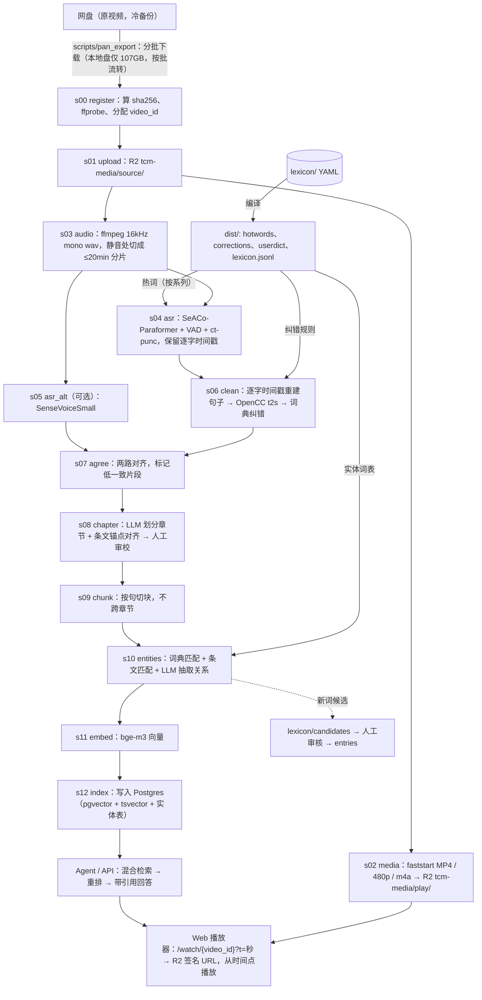

# 倪海厦中医讲座视频知识库 · 总体架构（v0.1）

> 状态：设计稿，2026-10-19（Asia/Shanghai）。ASR 选型依据见 `/workspace/asr-bench/results.md`。
> 版权：素材的使用权需在公开或商用发布前确认；在此之前按“个人/内部学习”范围构建。
> 免责：系统输出用于学习倪师讲授内容，不作为诊疗建议。

---

## 1. 目标与非目标

### 目标
1. 把约 200GB 讲座视频（估计 ≈400h 音频，约 300–500 个视频）转成**带时间戳的结构化文本知识**：讲座 → 章节 → 片段（chunk）→ 实体（证型/症状/经络/穴位/方剂/药材/六经/经典条文…）。
2. AI agent 能：
   - **按章节教学**：按课程（如《伤寒论》太阳篇）顺序讲解、总结、出题；
   - **精准引用**：每条结论附出处（系列/讲次/章节/时间段）和**跳到视频具体秒数**的链接；
   - **辨证类问答**：如“恶寒发热、汗出、脉浮缓，倪师怎么辨？”，通过实体关系（症状→证型→方剂）检索到原话。
3. 流水线**可重复、可续跑、可版本化**：改了词典或提示词，只重跑受影响的下游步骤。
4. 一份**共享中医词典（lexicon）**同时驱动：ASR 热词、ASR 后纠错、实体抽取、关键词检索分词。

### 非目标
- 不训练/微调大模型；模型里不存原始视频，只存文本+时间戳+向量。
- 不做诊断/开方系统；不评价倪师观点正确与否（只做“倪师怎么说”）。
- 第一阶段不做多用户付费、不做实时直播转写、不做逐字人工精校全集（只做抽检+重点章节审校）。
- 不迁移离开网盘：网盘保留为冷备份，R2 为播放与处理的主存储。

---

## 2. 技术选型（主推荐 + 取舍）

### 主推荐：**Python 后端 + PostgreSQL(pgvector) 作为知识库；Cloudflare 只负责媒体（R2）和前端/边缘（Pages + 一个 Worker）**

| 层 | 选择 | 理由 |
|---|---|---|
| 原视频冷备 | 用户网盘 | 已有，不动 |
| 媒体存储/播放 | Cloudflare R2（私有桶）+ 自定义域名 | 出口流量免费；S3 兼容，`rclone`/`boto3` 直接用 |
| 媒体格式 | MP4（H.264/AAC，`+faststart`）+ 纯音频 m4a 64kbps | faststart MP4 支持 HTTP Range，`?t=` 秒级跳转即可，无需 HLS；纯音频版本对弱网/国内访问友好 |
| 流水线语言 | Python 3.12（uv workspace） | FunASR/OpenCC/jieba/LLM SDK 都是 Python；与 asr-bench 复用 |
| ASR | FunASR SeACo-Paraformer + fsmn-vad + ct-punc + 热词；可选 SenseVoiceSmall 第二遍 | 已评测确定（术语命中最好，无幻觉/循环） |
| 知识库 | PostgreSQL 16 + `pgvector`（HNSW）+ `tsvector`（jieba 预分词，`simple` 配置） | 数据量很小（≈530 万字、≈1.4 万 chunk、几十万 mention），一个库搞定向量+关键词+关系+流水线状态，SQL 可做图式查询，事务/约束齐全 |
| Embedding | `BAAI/bge-m3`（1024 维 dense），自托管 | 中文强、可 CPU 跑；1.4 万 chunk CPU 约半小时内（估计） |
| 重排 | `BAAI/bge-reranker-v2-m3` | 中文重排效果好，top-50→top-8 |
| LLM | OpenAI 兼容接口抽象（`configs/llm.yaml` 可切换），章节划分/实体抽取/回答分别配置模型 | 不绑定供应商；批处理用便宜模型，回答用强模型 |
| API/Agent | FastAPI + 自写工具调用循环（不依赖重框架） | 工具少（检索/章节/实体/条文），自写更可控、易测 |
| 前端 | React + Vite（播放器 + 转写稿 + 对话 + 审校页），部署 Cloudflare Pages | 静态托管免费；播放器直接用 `<video>` |
| 媒体鉴权 | MVP：API 签发 R2 预签名 URL；后续：Worker 校验 HMAC token 后从 R2 读并走 CDN 缓存 | 预签名最快上线；Worker 方案可缓存、可限流 |
| 部署 | 一台 VPS（香港/东京/新加坡）Docker Compose：postgres + api；批处理在本 box 或临时 GPU 机 | 简单、便宜 |

### 备选方案与取舍
- **全 Cloudflare（Workers + D1 + Vectorize + Workers AI）**：免运维、与 R2 同生态；但 ① ASR/清洗仍必须是 Python，系统变成 TS+Python 两套；② D1 的 FTS5 无中文分词（trigram 对 2 字术语如“桂枝”“少阳”效果差），关键词检索要自己绕；③ Vectorize 与 D1 的联合过滤/重排需跨服务拼装；④ Workers AI 的 LLM 选择受限。**结论**：数据量小、检索逻辑复杂，选 Postgres；若以后想全上边缘，可把 chunk+向量导出到 D1/Vectorize（schema 已兼容：`chunk_id` 为文本主键）。
- **LanceDB（嵌入式）**：本地开发很顺手、零服务；但多进程写入/在线服务/关系查询不如 Postgres。可作为离线实验用，不作主库。

### R2 在中国大陆的访问说明
- Cloudflare 标准方案在大陆**没有节点**（China Network 需企业版 + ICP 备案），大陆用户一般绕到香港/新加坡/美西节点，延迟 150–400ms、晚高峰丢包/限速常见；`*.r2.dev` 域名有速率限制且不适合生产，必须绑**自定义域名**。
- 缓解：① 提供 480p 低码率版本 + 纯音频 m4a（约 30MB/小时）；② 播放器默认从引用点前 3 秒起播，只拉需要的 Range；③ 如主要用户在大陆且量大，再加一个国内镜像（阿里云 OSS / 腾讯云 COS + CDN，需 ICP 备案、有流量费），由 API 按用户地区返回不同媒体域名（`media_base_url` 可配置）。

---

## 3. 目录结构（monorepo）

```
tcm-video-kb/
├── README.md                     # 快速上手：环境、跑通一个视频
├── pyproject.toml                # uv workspace 根（统一依赖与 lint）
├── docs/
│   ├── ARCHITECTURE.md           # 本文档
│   ├── adr/                      # 架构决策记录（一事一文，如 0001-postgres-over-d1.md）
│   └── runbooks/                 # 操作手册：批量导入、GPU 批处理、重跑某步骤、备份恢复
├── configs/
│   ├── pipeline.yaml             # 各步骤参数、模型 ID、step 代码版本号、并发数
│   ├── series.yaml               # 系列目录：slug、中文名、对应经典、网盘路径规则、排序
│   ├── llm.yaml                  # LLM 端点/模型（按用途：chapter/extract/answer）
│   ├── prompts/                  # 版本化提示词（chaptering.v1.md、extract.v1.md、answer.v1.md）
│   └── .env.example              # R2、DB、LLM 密钥变量名（不含实际值）
├── lexicon/                      # 共享中医词典（人工维护的唯一事实来源）
│   ├── README.md                 # 编辑规范
│   ├── VERSION                   # 词典语义版本，如 0.3.0
│   ├── schema/lexicon_entry.schema.json   # 条目 JSON Schema（CI 校验）
│   ├── entries/                  # 按类别一个 YAML：formula.yaml、herb.yaml、acupoint.yaml …
│   ├── classics/                 # 经典原文条文（伤寒论 398 条、金匮、内经篇目），YAML/JSONL
│   ├── corrections/              # 非实体类纠错规则（常用口语误识、人名等）
│   ├── candidates/               # 自动挖掘的新词候选（待人工审核，不参与构建）
│   ├── tests/cases.yaml          # 纠错/匹配的正反例（防止误改）
│   └── dist/                     # 构建产物（gitignore）：hotwords/*.txt、corrections.json、jieba_userdict.txt、lexicon.jsonl
├── packages/
│   ├── tcmkb_core/               # 公共：pydantic 模型、配置加载、DB 连接、存储抽象（R2/本地）、ID 规则、日志
│   ├── tcmkb_lexicon/            # 词典校验/编译、Aho-Corasick 匹配、纠错引擎、热词集生成
│   ├── tcmkb_ingest/             # 流水线步骤 + 调度器 + CLI（`tcmkb run ...`）
│   │   └── src/tcmkb_ingest/steps/   # s00_register … s12_index，每步一个模块
│   ├── tcmkb_retrieval/          # 混合检索：向量/关键词/实体图召回、RRF 融合、重排、上下文扩展
│   └── tcmkb_agent/              # agent 工具定义、提示词组装、引用校验与时间戳精修
├── services/
│   ├── api/                      # FastAPI：/ask /search /curriculum /chapters /videos /play-url /admin/*
│   └── media-worker/             # Cloudflare Worker（TS）：校验 token、读 R2、Range/缓存（第二阶段）
├── web/                          # React+Vite：播放器（转写稿联动）、对话、章节审校、ASR 抽检页
├── db/
│   ├── migrations/               # 纯 SQL 迁移（dbmate），见 §6
│   └── seeds/                    # series/curriculum 初始数据
├── infra/
│   ├── docker-compose.yml        # postgres(pgvector) + api（本地/VPS 通用）
│   ├── docker/                   # Dockerfile：asr-cpu、asr-gpu、api
│   └── cloudflare/               # wrangler.toml、R2 CORS 规则、Pages 配置
├── scripts/                      # 一次性/运维脚本：网盘清单导出、分批下载上传、GPU 机初始化、数据导出
├── eval/
│   ├── asr/                      # 人工听写参考窗口 + CER/术语召回脚本（迁自 asr-bench）
│   ├── retrieval/qa.jsonl        # 问答评测集（问题 + 标准视频时间段）
│   ├── chapters/                 # 人工标注的章节边界样本
│   └── reports/                  # 每次评测输出（按日期/版本）
├── tests/
│   ├── unit/                     # 句子重建、纠错、切块、ID、版本键等
│   ├── integration/              # 用 fixtures 短音频跑完整流水线（CPU，<2 分钟）
│   └── fixtures/                 # 30–60s 测试音频、示例 ASR JSON
└── data/                         # 本地工作目录（gitignore）：下载缓存、wav、步骤产物缓存
```

---

## 4. 数据流



批量节奏（受本地 107GB 可用空间限制）：每批约 30–50GB：下载 → s00–s03 → 确认 R2 校验通过后删本地视频 → wav 跑完 ASR 后转 FLAC 存 R2 artifacts（或直接删除，可从 R2 重抽）。

---

## 5. 模块与程序架构

### 5.1 步骤（Step）契约
每个步骤是一个纯函数式单元：`run(video_id, inputs, config) -> outputs`，满足：
- **幂等**：输出写到由版本键决定的路径，重复执行结果相同、可覆盖；先写 `*.tmp` 再原子改名，最后写 `_SUCCESS.json`（含输出哈希与指标）。
- **可续跑**：调度器查状态表，`done` 且版本键一致则跳过；ASR 以音频分片为单位记录进度。
- **版本化**：`version_key = sha1(step_name + step_code_version + 相关config片段 + 上游输出哈希 + 相关词典哈希)[:12]`。上游或配置变化 → 版本键变化 → 自动判定需重跑；旧版本产物保留，`video.active_versions` 指向当前生效版本。
- 只有 s12 写知识库表（按 `video_id` 先删后插，单事务），其余步骤只写产物文件，便于回滚。

| 步骤 | 输入 | 输出（`artifacts/{video_id}/{step}/{version_key}/`） | 依赖的词典部分 |
|---|---|---|---|
| s00_register | 网盘本地文件 | `meta.json`（sha256、时长、编码、系列/讲次） | — |
| s01_upload | 源文件 | R2 `tcm-media/source/{video_id}.{ext}`（校验 ETag/大小） | — |
| s02_media | 源文件 | `play/{video_id}.mp4`、`play/{video_id}_480p.mp4`、`play/{video_id}.m4a` | — |
| s03_audio | 源文件 | `audio/part_000.flac…` + `parts.json`（每片 offset_s） | — |
| s04_asr | 音频分片 | `asr_raw.json`（全文 + 逐字 token 时间戳，已加 offset） | hotwords（按 series 选择） |
| s05_asr_alt | 音频分片 | `asr_alt.json`（SenseVoice 字级时间戳） | — |
| s06_clean | asr_raw | `segments.jsonl`（句子级，含 text_raw/edits） | corrections |
| s07_agree | segments + asr_alt | `segments.jsonl`（补 agreement/review_flag） | — |
| s08_chapter | segments | `chapters.json` | classics（条文锚点） |
| s09_chunk | segments + chapters | `chunks.jsonl` | jieba userdict |
| s10_entities | chunks + segments | `mentions.jsonl`、`relations.jsonl`、`candidates.jsonl` | lexicon.jsonl、classics |
| s11_embed | chunks | `embeddings.npy` + `ids.json` | — |
| s12_index | 以上全部 | Postgres 表 | — |

**词典变更的影响面**：改 corrections → 从 s06 起重跑（便宜，几分钟/全集）；改实体词表 → 从 s10 起；改热词 → **默认不重跑 ASR**（`pipeline.yaml` 中 `asr.hotword_set` 固定版本，需显式 `--force-step s04` 才重跑，因为 ASR 最贵）。

### 5.2 关键算法要点
- **s03 分片**：先 `ffmpeg -i in -vn -ac 1 -ar 16000 -c:a pcm_s16le`，再用 fsmn-vad/静音检测在 18–22 分钟区间找静音点切分；记录 `offset_s`，s04 把所有时间戳加回 offset。
- **s04**：`AutoModel(model="iic/speech_seaco_paraformer_large_asr_nat-zh-cn-16k-common-vocab8404-pytorch", vad_model="fsmn-vad", punc_model="ct-punc")`，`hotword=<dist/hotwords/{series}.txt>`（每系列 **≤50–100 词**，见 §7.4 与 `docs/SEACO_HOTWORD_RESEARCH.md`；SeACo ASF 默认只激活 top-50），`batch_size_s=300`。**不使用 `sentence_info`**（实测早 5–10 秒且断句错），只保留 `text`（已加标点）与字级 `timestamp`。
- **s06 句子重建**：把带标点 `text` 去标点后与 token 序列逐一对齐（英文/数字 token 按词对齐，对不上时用 difflib 局部对齐）；在 `。！？；` 处断句，另在 token 间隔 >1.2s 或句长 >40s 时强制断开；句子 `start_s/end_s` 取首末 token 时间。然后 OpenCC `t2s`，再应用纠错规则（句内替换，**不改时间戳**，记录 `edits`）。
- **s07**：两路文本字符级对齐，计算每句一致率；`agreement < 0.75` 或句中含词典术语且两路不一致 → `review_flag=true`。
- **s08 章节**：输入为 `[mm:ss] 句子` 列表；长视频按 40 分钟窗口、5 分钟重叠分段送 LLM，再合并相邻同题章节。输出须满足：时间单调、覆盖全片、边界吸附到句子起点、单章 3–25 分钟。另用经典条文模糊匹配（见 s10）给出“本章讲解第 N 条”的锚点，作为 LLM 的提示和校验。章节默认 `review_status=auto`。
- **s09 切块**：按句聚合，目标 300–600 字（约 1–2.5 分钟），重叠 1–2 句，不跨章节；`section_path = 系列 > 篇 > 讲次 > 章节标题`。
- **s10 实体**：① Aho-Corasick 匹配 canonical+aliases（遵循 `match_policy`，长词优先，消歧规则见 §7）；② 条文匹配：经典原文切 n-gram，与转写做模糊匹配（相似度 ≥0.8 记为 `clause_match`，倪师常先读原文再讲解）；③ LLM 按章节抽取关系（如 `symptom indicates syndrome`、`formula treats syndrome`、`acupoint on meridian`），必须给出证据句序号；不在词典里的术语进 `candidates.jsonl`。
- 所有 mention 通过句子序号换算成 `start_s/end_s`。

### 5.3 调度与并发
- 状态表 `step_run`（§6）即任务队列：worker 用 `SELECT … FOR UPDATE SKIP LOCKED` 领取任务，写 `lease_until`（心跳续租，超时自动回收）。
- 重试：指数退避（30s、2min、10min），`max_attempts=3`；错误分类：`transient`（网络/LLM 429）重试，`permanent`（文件损坏）直接 `failed` 并进人工清单。
- 并发建议（本 box 8 vCPU / 15GB）：s04 两个 worker（各 4 线程）；s02/s03 受 I/O 限制 2 个；LLM 步骤 4–8 并发（受限速）。GPU 机：s04 单进程大 batch。
- CLI：
  - `tcmkb run --series shl --until s12 --workers 2`
  - `tcmkb status --series shl`（每视频每步状态矩阵）
  - `tcmkb rerun --from s06 --video shl-003`
  - `tcmkb lexicon build|test|diff`

---

## 6. 数据模式

### 6.1 ID 规则
- `series_id`：短 slug，如 `shl`（伤寒论）、`jgy`（金匮要略）、`nj`（黄帝内经）、`bc`（神农本草经）、`zj`（针灸大成）。
- `video_id`：`{series_id}-{episode:03d}`，如 `shl-003`；内容身份另以 `source_sha256` 唯一约束。
- `segment`：`(video_id, seq)`；`chapter_id`：`shl-003:c02`；`chunk_id`：`shl-003:k0042`；`entity_id`：与词典 `id` 相同，如 `formula.guizhi_tang`。

### 6.2 SQL（PostgreSQL）
```sql
CREATE EXTENSION IF NOT EXISTS vector;

CREATE TABLE series (
  series_id    text PRIMARY KEY,
  title        text NOT NULL,              -- 伤寒论
  collection   text,                       -- 人纪 / 天纪 / 临床
  book_id      text,                       -- 对应 classics 的书 id
  sort         int  NOT NULL DEFAULT 0
);

CREATE TABLE video (
  video_id        text PRIMARY KEY,        -- shl-003
  series_id       text NOT NULL REFERENCES series,
  episode         int  NOT NULL,
  title           text NOT NULL,
  source_path     text NOT NULL,           -- 网盘原路径
  source_sha256   char(64) UNIQUE NOT NULL,
  source_bytes    bigint,
  duration_s      numeric(10,3),
  r2_source_key   text,                    -- source/shl-003.mp4
  r2_play_key     text,                    -- play/shl-003.mp4
  r2_play_lo_key  text,                    -- play/shl-003_480p.mp4
  r2_audio_key    text,                    -- play/shl-003.m4a
  active_versions jsonb NOT NULL DEFAULT '{}',  -- {"s06":"a1b2c3d4e5f6",...}
  created_at      timestamptz DEFAULT now(),
  UNIQUE (series_id, episode)
);

CREATE TABLE step_run (                    -- 每视频每步的清单/状态表（也是任务队列）
  video_id      text NOT NULL REFERENCES video,
  step          text NOT NULL,             -- s04_asr
  version_key   text NOT NULL,
  status        text NOT NULL CHECK (status IN ('pending','running','done','failed','skipped')),
  attempt       int  NOT NULL DEFAULT 0,
  worker_id     text,
  lease_until   timestamptz,
  input_hash    text,
  output_uri    text,                      -- r2://tcm-artifacts/shl-003/s04_asr/<vk>/
  output_hash   text,
  metrics       jsonb,                     -- {"rtf":0.048,"chars":21034,"flagged":37}
  error         text,
  started_at    timestamptz,
  finished_at   timestamptz,
  PRIMARY KEY (video_id, step, version_key)
);
CREATE INDEX ON step_run (status, step);

CREATE TABLE transcript_segment (          -- 句子级
  video_id      text NOT NULL REFERENCES video,
  seq           int  NOT NULL,
  start_s       numeric(10,3) NOT NULL,
  end_s         numeric(10,3) NOT NULL,
  text          text NOT NULL,             -- 清洗后（简体+纠错）
  text_raw      text NOT NULL,             -- ASR 原文
  edits         jsonb,                     -- [{"pos":5,"from":"竹山里","to":"足三里","rule":"acupoint.zusanli#e1"}]
  alt_text      text,                      -- SenseVoice 文本（可选）
  agreement     real,
  review_flag   boolean NOT NULL DEFAULT false,
  PRIMARY KEY (video_id, seq)
);

CREATE TABLE curriculum_node (             -- 教学用课程树：书 > 篇 > 节
  node_id    text PRIMARY KEY,             -- shl.taiyang.1
  parent_id  text REFERENCES curriculum_node,
  title      text NOT NULL,                -- 辨太阳病脉证并治（上）
  sort       int NOT NULL,
  clause_from int, clause_to int           -- 条文范围（如 1–30）
);

CREATE TABLE chapter (
  chapter_id     text PRIMARY KEY,         -- shl-003:c02
  video_id       text NOT NULL REFERENCES video,
  seq            int  NOT NULL,
  title          text NOT NULL,
  start_s        numeric(10,3) NOT NULL,
  end_s          numeric(10,3) NOT NULL,
  summary        text,
  key_points     text[],
  node_id        text REFERENCES curriculum_node,
  clause_refs    text[],                   -- {"clause.shl.012","clause.shl.013"}
  review_status  text NOT NULL DEFAULT 'auto' CHECK (review_status IN ('auto','approved','edited','rejected')),
  reviewed_by    text, reviewed_at timestamptz,
  version_key    text NOT NULL,
  UNIQUE (video_id, seq)
);

CREATE TABLE chunk (
  chunk_id      text PRIMARY KEY,          -- shl-003:k0042
  video_id      text NOT NULL REFERENCES video,
  chapter_id    text NOT NULL REFERENCES chapter,
  seq           int  NOT NULL,
  seg_from      int  NOT NULL, seg_to int NOT NULL,
  start_s       numeric(10,3) NOT NULL,
  end_s         numeric(10,3) NOT NULL,
  section_path  text NOT NULL,             -- 伤寒论 > 太阳篇 > 第3讲 > 桂枝汤证
  text          text NOT NULL,
  text_tok      text NOT NULL,             -- jieba(带词典) 空格分词结果
  tsv           tsvector GENERATED ALWAYS AS (to_tsvector('simple', text_tok)) STORED,
  embedding     vector(1024),
  embed_model   text NOT NULL,
  version_key   text NOT NULL
);
CREATE INDEX ON chunk USING hnsw (embedding vector_cosine_ops);
CREATE INDEX ON chunk USING gin (tsv);

CREATE TABLE entity (                      -- 由 lexicon.jsonl 同步
  entity_id    text PRIMARY KEY,           -- formula.guizhi_tang
  category     text NOT NULL,
  name         text NOT NULL,              -- 桂枝汤
  aliases      text[] NOT NULL DEFAULT '{}',
  attrs        jsonb,                      -- {"book":"伤寒论","clause":12} 等
  lexicon_ver  text NOT NULL
);

CREATE TABLE entity_mention (
  mention_id   bigserial PRIMARY KEY,
  entity_id    text NOT NULL REFERENCES entity,
  video_id     text NOT NULL REFERENCES video,
  chunk_id     text NOT NULL REFERENCES chunk,
  seg_seq      int  NOT NULL,
  start_s      numeric(10,3) NOT NULL,     -- 所在句开始
  end_s        numeric(10,3) NOT NULL,
  char_start   int, char_end int,          -- 句内偏移
  surface      text NOT NULL,              -- 原文表面形式
  method       text NOT NULL CHECK (method IN ('dict','clause_match','llm')),
  confidence   real NOT NULL DEFAULT 1.0
);
CREATE INDEX ON entity_mention (entity_id);
CREATE INDEX ON entity_mention (chunk_id);

CREATE TABLE entity_relation (             -- “倪师在某处说 A–关系–B”，带证据
  rel_id        bigserial PRIMARY KEY,
  subj_id       text NOT NULL REFERENCES entity,
  pred          text NOT NULL,             -- indicates / treats / composed_of / on_meridian / belongs_to / contraindicated
  obj_id        text NOT NULL REFERENCES entity,
  source        text NOT NULL CHECK (source IN ('lexicon','lecture')),
  evidence_chunk text REFERENCES chunk,
  evidence_s    numeric(10,3),
  confidence    real
);
CREATE INDEX ON entity_relation (subj_id, pred);
CREATE INDEX ON entity_relation (obj_id, pred);
```
`lexicon` 来源的关系（如方剂组成）是“书本知识”，`lecture` 来源的关系必须有证据片段与时间点，回答时只引用后者为“倪师说”。

### 6.3 产物 JSON 示例
`asr_raw.json`（s04）：
```json
{"video_id":"shl-003","engine":"seaco-paraformer","model_rev":"v2.0.4","hotword_set":"shl@0.3.0#9f2c",
 "parts":[{"part":0,"offset_s":0.0}],
 "text":"张仲景从伤寒到金匮，大概百分之六十以上的处方……",
 "tokens":[{"t":"张","s":12.34,"e":12.52},{"t":"仲","s":12.52,"e":12.70}]}
```
`segments.jsonl`（s06/s07）每行：
```json
{"video_id":"shl-003","seq":42,"start_s":754.12,"end_s":761.80,"text":"针扎到足三里以后要守气。","text_raw":"针扎到竹山里以后要守气。","edits":[{"pos":3,"from":"竹山里","to":"足三里","rule":"acupoint.zusanli#e1"}],"agreement":0.82,"review_flag":false}
```
`chapters.json`（s08）：
```json
[{"seq":2,"title":"桂枝汤证：太阳中风","start_s":612.0,"end_s":1490.5,"summary":"……","key_points":["阳浮阴弱","啬啬恶寒"],"clause_refs":["clause.shl.012"],"node_id":"shl.taiyang.1"}]
```

---

## 7. 共享中医词典（lexicon）规范（v0.1 已按此构建，见 lexicon/README.md）

### 7.1 位置与文件
- 源文件：`lexicon/entries/{category}.yaml`（每类一个文件，YAML 列表，UTF-8，简体为规范形）。
- 经典条文：`lexicon/classics/{book_id}.yaml`（如 `shanghanlun.yaml`，宋本 398 条编号；原文为古籍公有领域文本）。
- 非实体纠错：`lexicon/corrections/general.yaml`（如口头禅、人名“倪师”、非术语的固定误识）。
- 版本：`lexicon/VERSION`（semver）；构建产物带 `{VERSION}#{content_hash8}`。

### 7.2 类别（`category` 枚举）
| category | 中文 | 示例 | 默认进热词 |
|---|---|---|---|
| `formula` | 方剂 | 桂枝汤、小柴胡汤、大承气汤 | 是 |
| `herb` | 药材 | 桂枝、附子、干姜、炙甘草 | 是（单字药名除外） |
| `acupoint` | 穴位 | 足三里、合谷、内关、三阴交 | 是 |
| `meridian` | 经络 | 足阳明胃经、任脉、督脉 | 是 |
| `six_channel` | 六经 | 太阳、阳明、少阳、太阴、少阴、厥阴 | **否**（实测“厥阴”引起误插，仅用于抽取/纠错） |
| `syndrome` | 证型/病证 | 太阳中风、太阳伤寒、少阳证、阳明腑实 | 是（长词） |
| `symptom` | 症状 | 恶寒、发热、汗出、往来寒热、口苦 | 选择性 |
| `pulse` | 脉象 | 浮脉、沉脉、脉浮缓、弦脉 | 选择性 |
| `tongue` | 舌象 | 舌苔白腻、舌红少苔 | 否 |
| `method` | 治法 | 发汗、和解、温中、补泻手法 | 否 |
| `zangfu` | 脏腑 | 脾胃、肝胆、三焦 | 否 |
| `concept` | 理论概念 | 阴阳、五行、营卫、经方 | 选择性 |
| `disease` | 病名 | 中风、消渴、阑尾炎 | 否 |
| `classic` | 经典书名/篇名 | 伤寒论、金匮要略、黄帝内经、上古天真论 | 是 |
| `clause` | 经典条文 | 伤寒论第12条 | 否（走模糊匹配，见 classics/） |
| `person` | 人物 | 张仲景、倪海厦 | 是 |
| `course_term` | 倪师课程专有词 | 人纪、天纪、汉唐中医 | 是 |

### 7.3 条目 Schema（`schema/lexicon_entry.schema.json` 的语义）
```yaml
# lexicon/entries/acupoint.yaml
- id: acupoint.zusanli            # 必填，全局唯一，{category}.{拼音_slug}
  term: 足三里                     # 必填，规范名（简体）
  category: acupoint               # 必填，§7.2 枚举
  aliases: [三里]                  # 同义/别名（参与实体匹配，不进热词）
  pinyin: zu san li                # 可选，便于排序/候选挖掘
  hotword: true                    # 是否进 ASR 热词（默认按类别）
  hotword_scope: [global]          # global 或 series_id 列表，如 [zj, nj]
  asr_errors:                      # 已观察到的误识 → 自动生成纠错规则
    - {from: 竹山里, ctx: null}
    - {from: 足山里}
    - {from: 竹山, right: "里|穴"} # 仅当右侧为“里/穴”时才改，避免误改地名“竹山”
  match_policy: always             # always | context | never（实体匹配策略）
  context_any: []                  # match_policy=context 时，邻近 ±8 字内需出现其一
  relations:                       # 书本知识关系（source=lexicon）
    - {pred: on_meridian, obj: meridian.stomach_foot_yangming}
  attrs: {code: ST36}              # 类别专属属性（穴位编码、方剂出处条文等）
  status: draft                    # draft | reviewed；build.yaml 的 min_status 决定哪些进入构建（v0.1 为 draft）
  hotword_priority: 1              # 1 核心 / 2 系列 / 3 长尾；超 max_per_series(默认50) 时按此+频次截断
  sources:                         # 必填：出处（lexicon/sources/SOURCES.md 的 ref），无出处的写 {ref: unverified} 并在 attrs.verification 标注
    - {ref: zhwiki_shuxue, at: 足阳明胃经 36}
  notes: ""
```
`asr_errors[]` 字段：`from`（必填）、`to`（缺省 term）、`type: literal|regex`、`left`/`left_not`/`right`/`right_not`（紧邻 regex 守卫）、`near_any`+`window`（附近出现其一）、`note`（证据）。完整定义见 `lexicon/schema/lexicon_entry.schema.json`；条文文件见 `classic_clauses.schema.json`，通用纠错见 `correction_rule.schema.json`。
方剂示例：
```yaml
- id: formula.guizhi_tang
  term: 桂枝汤
  category: formula
  asr_errors: [{from: 桂子汤}, {from: 贵子汤}, {from: 鬼子汤}]
  hotword_scope: [global]
  relations:
    - {pred: composed_of, obj: herb.guizhi}
    - {pred: composed_of, obj: herb.baishao}
    - {pred: composed_of, obj: herb.zhigancao}
    - {pred: composed_of, obj: herb.shengjiang}
    - {pred: composed_of, obj: herb.dazao}
  attrs: {book: shanghanlun, clauses: [12, 13]}
  status: reviewed
```
六经（不进热词、需上下文）：
```yaml
- id: six_channel.taiyang
  term: 太阳
  category: six_channel
  hotword: false
  match_policy: context
  context_any: [病, 证, 经, 篇, 中风, 伤寒, 表]
  asr_errors: []
  status: reviewed
```
条文（`lexicon/classics/shanghanlun.yaml`）：
```yaml
book_id: shanghanlun
title: 伤寒论
edition: 宋本
clauses:
  - id: clause.shl.012
    no: 12
    section: 辨太阳病脉证并治上
    text: 太阳中风，阳浮而阴弱，阳浮者热自发，阴弱者汗自出，啬啬恶寒，淅淅恶风，翕翕发热，鼻鸣干呕者，桂枝汤主之。
    entities: [syndrome.taiyang_zhongfeng, formula.guizhi_tang]
```
非实体纠错（`corrections/general.yaml`）：
```yaml
- id: corr.jingfang
  from: 金方
  to: 经方
  right_not: "子|块"         # 可选：右侧排除
- id: corr.shanghan_1
  from: "张寒|仓寒|长寒"
  to: 伤寒
  type: regex
```

### 7.4 构建（`python -m tcmkb_lexicon build --root lexicon`）与三处用途
实现：`packages/tcmkb_lexicon`（validate / build / test / correct / match）；参数在 `lexicon/build.yaml`（`min_status`、热词上限、长度 2–8、系列列表）。热词机理与评测依据见 **`docs/SEACO_HOTWORD_RESEARCH.md`**。
1. **ASR 热词** → `dist/hotwords/{series}.txt` + `global.txt`（**一行一词、不写权重**；FunASR `hotword=` 传文件路径或空格串）
   - 选取：`status ≥ min_status` 且 `hotword=true`，`hotword_scope` 含该系列或 `global`；**`six_channel`、1 字词、任何纠错规则的 `from` 永不进热词**（留在 `corrections.json` / `lexicon.jsonl`）；
   - 长度：2–8 字（对齐论文训练 `l_min/l_max`；SDK 口头 ≤10）；
   - 排序：`rank = 2×hotword_priority + (0 系列专属 | 1 global)`，再按类、按名；**下一版叠加讲座频次 + 难召回（R1 类）术语**，防止「足三里」类高频词被截断；（**已观测**：仅降 cap、不改排序时 zj 的 50 词不含足三里——必须加频次或 pin）；
   - **上限 `max_per_series`：推荐 50–100，默认 50**（对齐 FunASR `_seaco_decode_with_ASF(nfilter=50)` / 论文 ASF k=50）。列表再长也会被 ASF 筛到 ~50，且论文 Fig.2 与本仓库评测均显示变长退化；
   - v0.1 实测（`eval/asr/out/score_v0_1.json`）：**400 词不优于基准 31 词**（zj CER 6.81% vs 5.93%）；纠错后处理收益更大。已知 ASR 混淆以 **`corrections.json` 为主路径**，热词只抬「难听清专名」的一过性召回；
   - 可选：在 `configs/asr.yaml` 暴露 `nfilter`（ASF k）与 `seaco_weight`（λ，论文默认 1.0）——须先确认当前 FunASR AutoModel 是否透传（见调研文 §5）。
2. **纠错词典** → `dist/corrections.json`：`rules`（由 entries 的 `asr_errors` 生成 id `{entity_id}#eN`，`to` 缺省为 term；加上 `corrections/*.yaml`）+ `protected_surfaces`（全部 term/alias）。
   引擎 `tcmkb_lexicon.correct.Corrector`：t2s 之后按句应用；同一位置最长匹配优先；守卫 `left/left_not/right/right_not`（regex，紧邻）与 `near_any+window`；
   命中位置若落在更长的合法词内（如「千金方」中的「金方」）则跳过；最多两遍（让「张寒到金桂」先改出「伤寒」再触发「金桂→金匮」）；返回 `edits[{pos,from,to,rule}]`，不改时间戳。
   validate 会拒绝「无守卫地改写合法词典词」的规则。`lexicon/tests/cases.yaml` 的 must_fix / must_not_fix / match 用例在 CI 中全部必须通过。
3. **实体抽取/检索** → `dist/lexicon.jsonl`（词条 + 398 条条文实体，带 `lexicon_ver`）+ `dist/jieba_userdict.txt`（`词 频次 n_{category}`）。
   `tcmkb_lexicon.match.Matcher`：最长匹配，遵循 `match_policy`（never 不匹配；context 需 ±8 字内出现 `context_any` 之一；单字词只在 context 策略下匹配）；同形异义（如 太阳=六经/奇穴、带脉=经脉/穴位）返回多个候选 id，由上下文或 LLM 消歧；validate 把同形词列为 warning。
- 另输出 `dist/build_info.json`（版本 `VERSION#内容哈希`、各类计数、热词截断数）与 `dist/warnings.txt`。
- 词典回流：s10 的 `candidates.jsonl` 汇总到 `lexicon/candidates/`，人工审核后并入 entries。
- v0.1 实际规模（全部 draft）：1754 词条 + 398 条文，详见 lexicon/sources/seed_report.json；超出原定 ~500 是因为 361 经穴、本草经 359 味、伤寒/金匮 234 方、内经 162 篇名均整体收录。

## 8. Agent 检索与回答流程

### 8.1 工具（agent 可调用）
| 工具 | 作用 |
|---|---|
| `search_knowledge(query, filters{series,chapter,category}, k)` | 混合检索，返回带时间戳的 chunk |
| `get_entity(term_or_id)` | 实体详情 + 倪师讲到它的高频位置 + 关系（含证据） |
| `diagnose_path(symptoms[])` | 症状 → 证型 → 方剂 的关系展开（仅 lecture 来源关系，附证据） |
| `get_clause(book, no)` | 条文原文 + 倪师讲解该条的章节/时间段 |
| `list_curriculum(book)` / `get_chapter(chapter_id)` | 课程树、章节摘要与该章全部 chunk，供按章教学 |

### 8.2 问答流程
1. **查询理解**：OpenCC t2s → 词典自动机识别实体（如“恶寒”“脉浮缓”“桂枝汤”）→ LLM 改写出 1–2 个检索式（口语化→术语化）。
2. **三路召回**（并行，各 top-30）：
   - 向量：`ORDER BY embedding <=> $q LIMIT 30`；
   - 关键词：jieba 分词 → `tsv @@ plainto_tsquery('simple', $tok)`，`ts_rank`；
   - 实体：命中实体的 `entity_mention` → 所在 chunk（按实体数量/置信度打分）；辨证类问题再经 `entity_relation` 扩展一跳。
3. **融合**：RRF（k=60），去重后 top-50 → bge-reranker 重排 → top-8；同一章节最多 3 块，保证多样性。
4. **上下文组装**：每块前后各扩 1 句；标注为 `[C1] shl-003 | 伤寒论>太阳篇>第3讲>桂枝汤证 | 12:34–14:05`。
5. **生成**：系统提示要求：只依据上下文回答“倪师怎么讲”；每个论断后标 `[C1]`；每个引用附一句 ≤30 字原话 `quote`；资料不足时直说。
6. **引用校验与时间戳精修**（`tcmkb_agent.citations`）：
   - 引用 id 必须存在，否则删除该引用并降级措辞；
   - `quote` 与 chunk 文本做模糊匹配（≥0.8），定位到具体句子 → 用**该句 `start_s`** 作为跳转点（比 chunk 起点更准），预留 3 秒前导：`t = max(0, start_s - 3)`；
   - 匹配不上则退回 chunk 的 `start_s`。

### 8.3 引用格式
回答正文：
> 倪师认为桂枝汤证的关键在“汗出、恶风、脉浮缓”，是营卫不和 [1]；针刺足三里时讲究补泻手法 [2]。

引用列表（前端渲染为可点击卡片）：
```
[1] 《伤寒论》第3讲 · 桂枝汤证：太阳中风 · 12:31–14:05 ▶ https://kb.example.com/watch/shl-003?t=751&end=845
    “阳浮而阴弱，就是你的卫气浮在外面……”
[2] 《针灸大成》第50讲 · 足三里补泻 · 03:12–04:40 ▶ https://kb.example.com/watch/zj-050?t=189&end=280
```
API 返回结构：
```json
{"answer":"……[1]……[2]","citations":[{"n":1,"chunk_id":"shl-003:k0042","video_id":"shl-003","chapter_title":"桂枝汤证：太阳中风","section_path":"伤寒论 > 太阳篇 > 第3讲","start_s":751.0,"end_s":845.0,"quote":"阳浮而阴弱，就是……","url":"https://kb.example.com/watch/shl-003?t=751&end=845"}]}
```

### 8.4 深链播放
- `/watch/{video_id}?t=秒[&end=秒][&q=lo|audio]` → 前端调 `GET /api/play-url/{video_id}?q=` 拿签名 URL（有效 4 小时）→ `<video src>` 加载后 `currentTime = t`；`end` 用于高亮引用区间。转写稿面板与播放进度联动，点任意句子可跳转。
- 也支持标准媒体片段 `#t=751,845`，便于复制到别处。

### 8.5 按章节教学模式
`教我《伤寒论》太阳篇上` → `list_curriculum` → 逐个 `curriculum_node` 取已审校章节（`review_status in (approved, edited)` 优先）→ 生成：本节要点、条文原文、倪师讲解要点（带引用与跳转）、3 道自测题 → 用户说“下一节”继续。（学习进度表 `learner_progress` 放到第二阶段。）

---

## 9. 质量控制

| 环节 | 方法 | 指标/门槛 |
|---|---|---|
| ASR 抽检 | 每系列每 10 讲随机抽 1 个 2 分钟窗口，**人工听写**参考（`eval/asr/`），web 抽检页可边听边改 | 总 CER（目标 ≤8%）、**术语召回率**（词典术语正确识别比例，目标 ≥90%） |
| 重点复核 | `review_flag=true` 的句子（两路不一致/术语冲突）进入复核队列，按术语密度排序 | 每系列复核前 200 句；修正写回 `segment_override` 文件（不改 ASR 原始产物） |
| 纠错安全 | `lexicon/tests/cases.yaml` 正反例；每次词典构建后统计“被纠错次数 Top 50”人工过目 | 反例 0 误改 |
| 章节 | 审校页：列出章节标题/摘要，点击边界前后 10 秒试听，可拖动边界、改标题、合并/拆分；状态 approved/edited | MVP 系列 100% 审校；全集抽 20%；边界误差 ≤15 秒 |
| 实体 | 每类抽 50 条 mention 人工判对错 | dict 精确率 ≥95%；llm 关系精确率 ≥85%，否则该关系类型不对外 |
| 检索/回答 | `eval/retrieval/qa.jsonl`：问题 + 标准 `video_id` 与时间区间（±30 秒算命中），含辨证题、条文题、穴位手法题、跨系列题 | Recall@8 ≥85%；引用正确率（人工/LLM 评审）≥90%；跳转点落在相关话语前 0–10 秒 ≥90% |
| 回归 | 每次改提示词/词典/模型，跑 `tcmkb eval` 出报告到 `eval/reports/{date}_{version}.md` | 指标不下降才合并 |

评测集规模：MVP 50 题 → 全量 200 题（需懂中医的人参与出题，见开放问题）。

---

## 10. 成本与时间（估计值，未实测部分已标注）

- **数据量**：≈400h 音频（区间 200–670h，取决于码率）；约 400h × 220 字/分钟 ≈ **530 万字**，≈1.2–1.4 万 chunk。
- **网盘下载**：大概率是总时长瓶颈（取决于网盘限速/会员），200GB 在 10MB/s 下约 6 小时，在 2MB/s 下约 28 小时。
- **R2**：200GB 源 + 播放副本（faststart 多为 remux，480p+音频约 +30%）≈ 260–400GB × $0.015/GB·月 ≈ **$4–6/月**；出口免费；操作费可忽略。
- **ASR（实测 RTF 外推）**：本 box 8 核 CPU SeACo-Paraformer ≈19h（10–32h）；单张云 GPU 估计 2–4h（RTF 未实测）+ 环境准备，租用费估计 <$20。SenseVoice 第二遍 CPU ≈11h。
- **抽音频**：ffmpeg I/O 约 1–3h；wav 16kHz 单声道 ≈115MB/h → 全量约 46GB（转 FLAC 约减半），按批处理后删除。
- **LLM（估计）**：章节划分输入 ≈530 万字 × 窗口重叠 1.15 ≈ 600 万 token 级；实体关系抽取再 ≈600 万；合计输入约 1200–1500 万 token、输出约 100–200 万 token。用国产低价模型约 ¥50–300；用顶级模型约 $100–300。建议先用 MVP 系列实测单价再定。
- **Embedding/重排**：bge-m3 CPU 本地跑，全量估计 <1h；无 API 费用。
- **在线**：VPS（2C4G 起，香港/东京）约 $10–20/月；问答 LLM 按次计费。
- **人工**：MVP 系列章节审校约每小时视频 10 分钟；ASR 抽检全量约 40 个窗口 × 15 分钟。

---

## 11. 里程碑

| 里程碑 | 内容 | 验收 |
|---|---|---|
| **M0 骨架（约 1 周）** | monorepo、configs、DB 迁移、`step_run` 调度器；词典 v0.1（≈500 条 + 伤寒论 398 条）及构建/测试；用 asr-bench 的 3 段音频跑通 s03–s09 | `tcmkb run` 可续跑；单测 + 集成测试通过 |
| **M1 MVP：一个系列（建议《伤寒论》，约 1–2 周）** | 该系列全部视频：上传 R2 → s12；词典匹配实体；混合检索 + 重排；API `/ask` + 简版播放器深链；章节 100% 审校；评测集 50 题 | Recall@8 ≥80%，引用可点开并从正确时间播放 |
| **M2 质量（约 2 周）** | SenseVoice 第二遍 + 复核队列；LLM 关系抽取 + `diagnose_path`；条文锚点；按章教学模式；审校/抽检页面完善；评测集 150 题 | §9 门槛达标 |
| **M3 全量 200GB（约 1–2 周，受下载速度影响）** | 分批下载上传；GPU 批量 ASR；全部系列跑到 s12；全集章节抽审；词典迭代到 v1.0（候选回流） | 所有视频 `step_run` 全 done；抽检指标达标 |
| **M4 上线加固** | 访问鉴权、Worker 媒体网关与缓存、国内访问方案（低码率/镜像）、监控与备份（pg_dump 到 R2）、学习进度 | 按目标用户范围发布（先确认版权） |

---

## 12. 待确认问题（需要用户决定）
1. 网盘是哪家（百度/阿里/115…）、是否有会员（决定下载速度与方式），目录如何组织（能否从路径解析系列/讲次）？
2. 使用范围：仅自己学习、小范围分享还是公开？用户主要在中国大陆吗？（决定鉴权、国内镜像、版权确认的时点）
3. 内容范围：只做“人纪”（内经/本草/针灸/伤寒/金匮）+ 临床类，还是也包含天纪/地纪等非中医内容？
4. LLM 偏好与预算：可否把转写文本发往境外 API？批处理与问答分别愿意用哪档模型？
5. 是否有懂中医的人参与审校章节、编写评测题和审核词典候选？
6. 是否已有现成的文字稿/字幕（社区整理的倪师讲稿）可作为 ASR 参考或校对来源？
